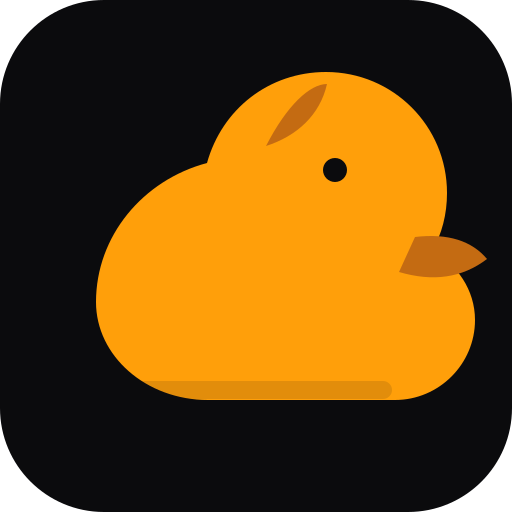
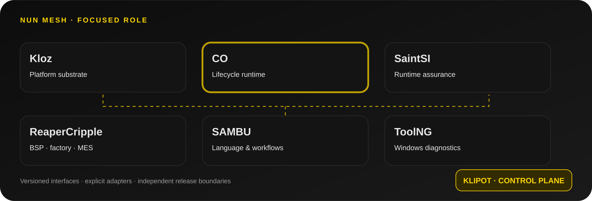

<p align="center"></p>
<h1 align="center">CO</h1>
<p align="center"><strong>Deterministic Component Lifecycle Runtime</strong></p>
<p align="center"><strong>Host-tested C11 core</strong></p>
<p align="center"><a href="README.md">🇺🇦 Українська</a> · <a href="README.en.md">🇬🇧 English</a> · <a href="README.ru.md">🇷🇺 Русский</a></p>
<sub>Updated: 2026-11-11</sub>


## Contents

- [Current capabilities](#current-capabilities)
- [Quick start and verification](#quick-start-and-verification)
- [Architecture and verified scope](#architecture-and-verified-scope)
- [Interface and architecture visuals](#interface-and-architecture-visuals)
- [Engineering quality](#engineering-quality)
- [Documentation map](#documentation-map)
- [NUN Mesh and related repositories](#nun-mesh-and-related-repositories)
- [Design and documentation](#design-and-documentation)
- [License](#license)
- [Duck Black / Yellow palette](#duck-black-yellow-palette)

> **CO** — CO is a compact C11 runtime for predictable component startup, stepping and shutdown without requiring a full RTOS.

## Current capabilities
- Explicit STOPPED, STARTING, RUNNING, STEPPING, FAULTED and STOPPING states.
- Runtime storage supplied by the caller; no heap allocation.
- init, step and shutdown callbacks with error propagation.
- Recursion guards and host tests for fault and partial-initialization paths.

## Quick start and verification
```bash
make test
make clean
python one.py check
```

## Architecture and verified scope
CO does not implement preemption, an interrupt scheduler or MMIO. The caller serializes access across independent contexts; scheduling, priorities, deadlines and watchdog policy remain external.

## Interface and architecture visuals

CO is a compact C11 runtime component without a graphical interface. No GUI screenshots are available; the visuals below show the ecosystem map and shared Duck UI direction, not a CO interface.

<p align="center"></p>
<p align="center"><em>Ecosystem map</em></p>
<p align="center"></p>

## Engineering quality
- Run the checks appropriate to the target platform; host CI is not hardware qualification.
- Mark capabilities as implemented, partial or planned according to code, tests and evidence.
- A mockup, specification or open pull request is not proof of a production-ready feature.
- External integrations must be explicit, versioned, isolated and testable.

## Documentation map

- [Execution model](docs/execution-model.md)
- [Signal pipeline lifecycle](docs/SIGNAL_PIPELINE_LIFECYCLE.md)
- [Runtime archetype mapping](docs/ARCHETYPE_RUNTIME_MAPPING.md)

## NUN Mesh and related repositories
[SAMBU](https://github.com/bboroski/SAMBU) · [ToolNG](https://github.com/bboroski/ToolNG) · [ReaperCripple](https://github.com/bboroski/ReaperCripple) · [Kloz](https://github.com/bboroski/Kloz) · [CO](https://github.com/bboroski/CO) · [SaintSI](https://github.com/bboroski/SaintSI) · [Klipot](https://github.com/bboroski/Klipot) · [NUN](https://github.com/bboroski/NUN) · [NUNLauncher](https://github.com/bboroski/NUNLauncher)

Each repository retains its canonical name, code, APIs, release lifecycle and ownership boundaries. Integration means versioned contracts, not automatic merging of independent runtimes.

## Design and documentation
The shared interface direction is **Duck Black / Yellow**: dark surfaces, yellow accents for actions and state, readable typography, accessible contrast, keyboard navigation and reduced-motion support. See [design/DUCK_UI_SYSTEM.md](design/DUCK_UI_SYSTEM.md) when present.

## License
License not declared; no LICENSE file is present.

---
**Built with care for engineering, clarity and people.**


## Duck Black / Yellow palette
The legacy badge and mark compatibility colors remain `#FFD600` (yellow) and `#111111` (near-black). The current interface canvas is `#0D0D0D`. The complete six-color palette, fourteen functional shades and RGB/HSL values are maintained in `design/duck-ui.tokens.json` (schema 3.0.0). Yellow is reserved for primary actions, focus and selection; red and cyan identify semantic error and information states.
