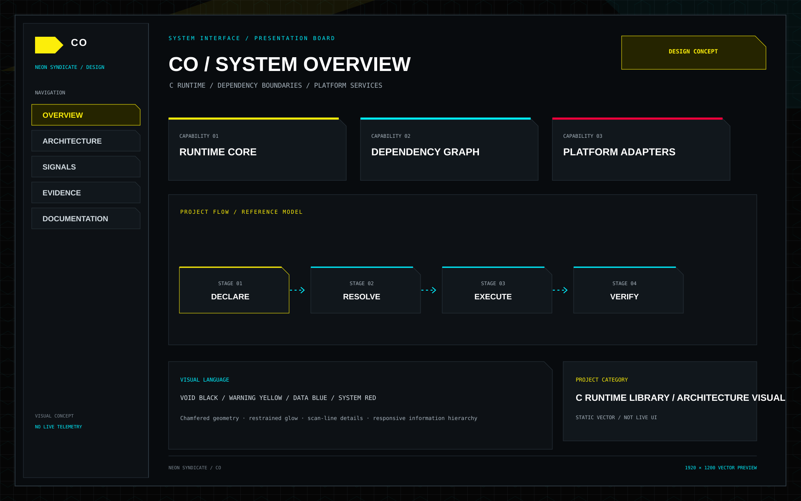

<p align="center"></p>
<h1 align="center">CO</h1>
<p align="center"><strong>Deterministic Component Lifecycle Runtime</strong></p>
<p align="center"></p>
<p align="center"><a href="README.md">🇺🇦 Українська</a> · <a href="README.en.md">🇬🇧 English</a> · <a href="README.ru.md">🇷🇺 Русский</a></p>
<sub>Оновлено: 2026-11-11</sub>


## Навігація

- [Поточні можливості](#поточні-можливості)
- [Швидкий старт і перевірка](#швидкий-старт-і-перевірка)
- [Архітектура, межі та достовірність](#архітектура-межі-та-достовірність)
- [Інтерфейс і архітектурна візуалізація](#інтерфейс-і-архітектурна-візуалізація)
- [Інженерна якість](#інженерна-якість)
- [Карта документації](#карта-документації)
- [NUN Mesh та пов'язані репозиторії](#nun-mesh-та-повязані-репозиторії)
- [Дизайн і документація](#дизайн-і-документація)
- [Ліцензія](#ліцензія)

> **CO** — CO — компактний C11 runtime для передбачуваного запуску, виконання кроків і завершення компонентів без вимоги повноцінної RTOS.


## NEON SYNDICATE — візуальна система

<p align="center"></p>
<p align="center"><em>Векторна схема lifecycle runtime, а не скриншот виконання чи live telemetry.</em></p>

[Брендбук](design/NEON_SYNDICATE.md) · [Токени](design/neon-syndicate.tokens.json)

## Поточні можливості
- Явна машина станів STOPPED, STARTING, RUNNING, STEPPING, FAULTED і STOPPING.
- Runtime-об'єкт у пам'яті, наданій викликачем; heap не використовується.
- Callback API init, step і shutdown з передаванням помилок.
- Захист від рекурсивних poll/stop під час callback.
- Host-тести старту, fault paths, часткової ініціалізації та recursion guards.

## Швидкий старт і перевірка
```bash
make test
make clean
python one.py check
```

## Архітектура, межі та достовірність
CO не реалізує preemption, interrupt scheduler або MMIO. Викликач серіалізує доступ із незалежних контекстів; scheduling, priorities, deadlines і watchdog залишаються зовнішніми.

## Інтерфейс і архітектурна візуалізація

CO — компактний C11 runtime-компонент без графічного інтерфейсу. Скриншотів GUI немає; нижче наведено карту екосистеми та загальний дизайн-напрям Duck UI, не інтерфейс CO.

<p align="center"></p>
<p align="center"><em>Карта екосистеми</em></p>
<p align="center"></p>

## Інженерна якість
- Перевіряйте збірку й тести саме для цільової платформи; host CI не замінює hardware qualification.
- Статуси **implemented**, **partial**, **planned** мають підтверджуватися кодом, тестами та документацією.
- Не оголошуйте функцію production-ready лише на підставі макета, специфікації чи відкритого Pull Request.
- Зовнішні інтеграції мають бути явними, версіонованими, ізольованими й перевірюваними.

## Карта документації

- [Модель виконання](docs/execution-model.md)
- [Життєвий цикл сигналів](docs/SIGNAL_PIPELINE_LIFECYCLE.md)
- [Мапування runtime-архетипів](docs/ARCHETYPE_RUNTIME_MAPPING.md)

## NUN Mesh та пов'язані репозиторії

<p align="center"></p>
[SAMBU](https://github.com/bboroski/SAMBU) · [ToolNG](https://github.com/bboroski/ToolNG) · [ReaperCripple](https://github.com/bboroski/ReaperCripple) · [Kloz](https://github.com/bboroski/Kloz) · [CO](https://github.com/bboroski/CO) · [SaintSI](https://github.com/bboroski/SaintSI) · [Klipot](https://github.com/bboroski/Klipot) · [NUN](https://github.com/bboroski/NUN) · [NUNLauncher](https://github.com/bboroski/NUNLauncher)

Репозиторії зберігають власні назви, код, API, цикли випуску та межі відповідальності. Інтеграція означає узгоджені контракти, а не автоматичне злиття незалежних runtime.

## Дизайн і документація
Базовий інтерфейсний напрям екосистеми — **NEON SYNDICATE**: чорні поверхні, жовтий акцент для дій і станів, читабельна типографіка, доступний контраст, клавіатурна навігація та підтримка reduced motion. Деталі дивіться в [design/DUCK_UI_SYSTEM.md](design/DUCK_UI_SYSTEM.md), якщо файл присутній у цьому репозиторії.

## Ліцензія
Ліцензію не оголошено; файл LICENSE відсутній.

---
**Створено з любов'ю до інженерії, системності та людей.**

## Федерація Hellduck

Цей репозиторій входить до федерації [Hellduck](https://github.com/bboroski/Hellduck) — спільного каталогу проєктів, контрактних зв’язків і станів інтеграції. Вихідний код, API, тести та цикл випуску залишаються відповідальністю цього репозиторію; Hellduck індексує зв’язки й не завантажує та не виконує код учасників. Практичні сценарії взаємодії, типи адаптерів і межі сумісності: [Integration Playbook](https://github.com/bboroski/Hellduck/blob/main/docs/INTEGRATION_PLAYBOOK.md).
