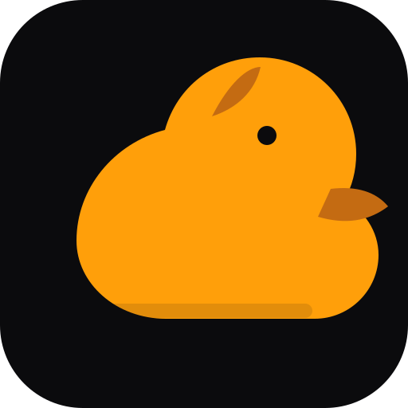
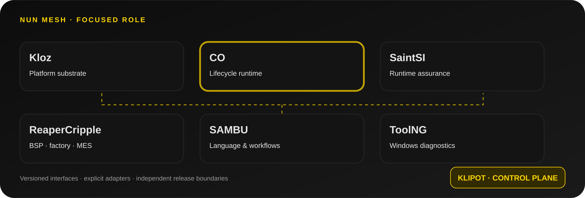

<h1 align="center">CO</h1>

<strong>Deterministic Component Lifecycle Runtime</strong>

<a href="README.md">🇺🇦 Українська</a> · <a href="README.en.md">🇬🇧 English</a> · <a href="README.ru.md">🇷🇺 Русский</a>

**Невеликий C11 runtime для передбачуваного запуску, виконання кроків і завершення вбудованих компонентів.**

## Продуктова роль

CO надає зрозумілий життєвий цикл для компонентів, яким не потрібен повноцінний RTOS. Бібліотека розділяє ініціалізацію, робочий крок, помилку та зупинку, залишаючи контроль над пам'яттю й контекстом виконання у викликачеві.

## Реалізовані можливості

- Явна машина станів, включно із захищеним станом <code>STEPPING</code>.
- Runtime-об'єкт із пам'яттю, що належить викликачеві; heap не використовується.
- Callback-інтерфейси <code>init</code>, <code>step</code> і <code>shutdown</code>.
- Передавання помилок callbacks і збереження останнього результату.
- Насичувальний лічильник циклів виконання.
- Відхилення рекурсивних <code>poll</code>/<code>stop</code> під час callback.
- Host-тести старту, помилок, часткової ініціалізації та захисту від рекурсії.

## Модель станів

~~~text
STOPPED -> STARTING -> RUNNING -> STEPPING -> RUNNING
              |          |          |
              +--------> FAULTED <---+
FAULTED -> STOPPING -> STOPPED
RUNNING -> STOPPING -> STOPPED
~~~

Callback завершення викликається після спроби ініціалізації, зокрема після часткової невдачі. Він має коректно обробляти неповне налаштування.

## Збірка та перевірка

Потрібні C11-компілятор і Make.

~~~sh
make test
make clean
~~~

GitHub Actions запускає host-тести з GCC і Clang. One-knob runner: <code>python one.py</code>; перевірки: <code>python one.py check</code>.

## Управління проєктом і критерії випуску

| Контрольна точка | Правило |
|---|---|
| Пам'ять | Runtime використовує пам'ять, надану викликачем |
| Життєвий цикл | Стани та помилки є явними |
| Callback safety | Рекурсивні poll/stop відхиляються |
| Host CI | Перевірки GCC і Clang мають проходити |
| Інтеграція | Викликач серіалізує доступ між незалежними контекстами |

## Межі відповідальності

- CO не володіє allocator і не створює heap.
- CO не реалізує preemption або interrupt scheduler.
- CO не записує MMIO-регістри.
- Викликач серіалізує доступ із незалежних контекстів виконання.
- Політика планування, пріоритети, deadlines і watchdog залишаються окремими модулями.

Канонічний API використовує префікс <code>co_</code>. Старий заголовок <code>co/runtime.h</code> надає source-level псевдоніми; бінарні файли зі старими символами потрібно перелінкувати.

## Документація

- [Модель виконання](docs/execution-model.md)

## Екосистема

[SAMBU](https://github.com/bboroski/SAMBU) · [ToolNG](https://github.com/bboroski/ToolNG) · [ReaperCripple](https://github.com/bboroski/ReaperCripple) · [Kloz](https://github.com/bboroski/Kloz) · [SaintSI](https://github.com/bboroski/SaintSI) · [Klipot](https://github.com/bboroski/Klipot) · [NUN](https://github.com/bboroski/NUN) · [NUNLauncher](https://github.com/bboroski/NUNLauncher).

## Ліцензія

Проєктна документація раніше заявляла MIT, але окремого файлу LICENSE у репозиторії немає. Підтвердіть ліцензію та додайте її повний текст перед розповсюдженням.

## Reaper-inspired engineering integration

- [Project-specific architecture mapping](docs/REAPER_DOMAIN_INTEGRATION.md)
- [Canonical 50-pattern catalogue in SAMBU](https://github.com/bboroski/SAMBU/blob/main/data/reaper/engineering_patterns_50.tsv)

## Optional operator UI preview

Open `ui/index.html` for the CO lifecycle inspector concept. The state graph maps the explicit runtime transitions and the controls simulate start, one step poll, callback fault and stop locally. This preview does not call the CO C library, create worker threads or implement a scheduler.
