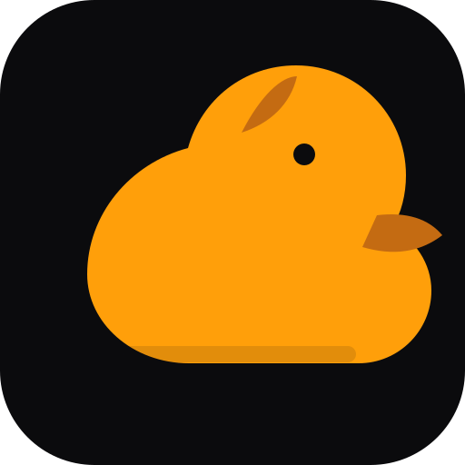

<h1 align="center">CO</h1>

<strong>Deterministic Component Lifecycle Runtime</strong>

<a href="README.md">🇺🇦 Українська</a> · <a href="README.en.md">🇬🇧 English</a> · <a href="README.ru.md">🇷🇺 Русский</a>

**Компактный runtime на C11 для предсказуемого запуска, выполнения рабочих шагов и остановки embedded-компонентов.**

## Позиционирование

CO предоставляет явный жизненный цикл компонентам, которым не нужна полноценная RTOS. Он разделяет инициализацию, рабочий шаг, ошибку и остановку, оставляя владение памятью и контекстом выполнения вызывающей стороне.

## Реализованные возможности

- Явная машина состояний, включая защищённое состояние <code>STEPPING</code>.
- Runtime-объект на памяти, принадлежащей вызывающей стороне; heap не используется.
- Callback-интерфейсы <code>init</code>, <code>step</code> и <code>shutdown</code>.
- Передача ошибок callbacks и сохранение последнего результата.
- Насыщающий счётчик циклов выполнения.
- Отказ от рекурсивных вызовов <code>poll</code>/<code>stop</code> во время callback.
- Host-тесты запуска, ошибок, частичной инициализации и защиты от рекурсии.

## Модель состояний

~~~text
STOPPED -> STARTING -> RUNNING -> STEPPING -> RUNNING
              |          |          |
              +--------> FAULTED <---+
FAULTED -> STOPPING -> STOPPED
RUNNING -> STOPPING -> STOPPED
~~~

Callback завершения вызывается после попытки инициализации, включая частичную неудачу. Он должен корректно обрабатывать неполную настройку.

## Сборка и проверка

Нужны компилятор C11 и Make.

~~~sh
make test
make clean
~~~

GitHub Actions запускает host-тесты с GCC и Clang. Единая точка запуска: <code>python one.py</code>; проверки: <code>python one.py check</code>.

## Управление проектом и критерии выпуска

| Контрольная точка | Правило |
|---|---|
| Память | Runtime использует память, предоставленную вызывающей стороной |
| Жизненный цикл | Состояния и ошибки заданы явно |
| Callback safety | Рекурсивные poll/stop отклоняются |
| Host CI | Проверки GCC и Clang должны проходить |
| Интеграция | Вызывающая сторона сериализует доступ из независимых контекстов |

## Границы ответственности

- CO не владеет allocator и не создаёт heap.
- CO не реализует preemption или interrupt scheduler.
- CO не записывает MMIO-регистры.
- Вызывающая сторона сериализует доступ из независимых контекстов исполнения.
- Политика планирования, приоритеты, deadlines и watchdog остаются отдельными модулями.

Канонический API использует префикс <code>co_</code>. Старый заголовок <code>co/runtime.h</code> предоставляет source-level псевдонимы; бинарные файлы со старыми символами нужно перелинковать.

## Документация

- [Модель выполнения](docs/execution-model.md)

## Экосистема

[SAMBU](https://github.com/bboroski/SAMBU) · [ToolNG](https://github.com/bboroski/ToolNG) · [ReaperCripple](https://github.com/bboroski/ReaperCripple) · [Kloz](https://github.com/bboroski/Kloz) · [SaintSI](https://github.com/bboroski/SaintSI) · [Klipot](https://github.com/bboroski/Klipot) · [NUN](https://github.com/bboroski/NUN) · [NUNLauncher](https://github.com/bboroski/NUNLauncher).

## Лицензия

MIT — см. [LICENSE](LICENSE).
